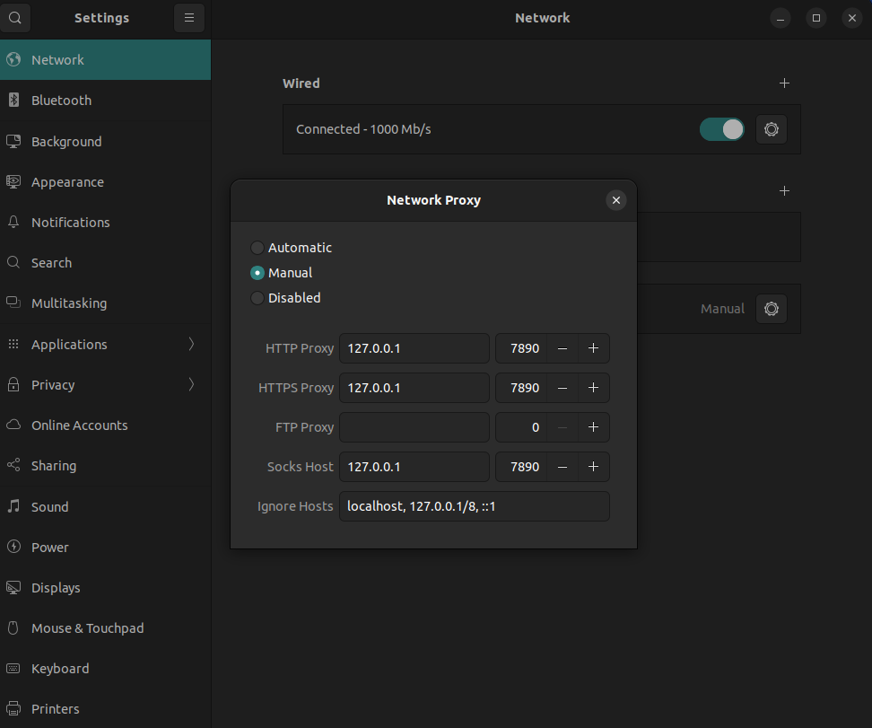

# 技术问题的解决

搭建博客、终端代理、GitHub 端口、iCloud 路径，以及 Intel Mac 安装 Linux 后无法联网。每一篇记一个问题。

## 博客问题

学长的博客搭建笔记：<https://cs.haohaha.cn/03-blog/01-init/tutorial/>

### 搭建过程疑问的解决笔记

我通常在 Repo 这个文件夹及其子文件设置了与 GitHub 的连接，其中 fy-blog 文件夹用来写博客，GitHub 也有同名仓库。现在我在 Obsidian 文件夹下将 Repo 拷贝了过来，然后用这个新的 Repo 作为我与 GitHub 建立连接的文件树根。我正在尝试重新将新的 fy-blog 连接至远程仓库，但 GitHub 报错，说已经存在 fy-blog 这个仓库。是不是需要删除这个仓库，然后重新输入这些连接命令？

```text
fy-blog on master [!]
git config --global user.name "fighteryyds"
git config --global user.email "1591715509@qq.com"
git remote add fy-blog GITHUB_REMOTE
error: remote fy-blog already exists.
```

你本地的新 fy-blog 目录里已经拷贝了原仓库的 `.git`，所以远端别名 fy-blog 也一起复制过来了。`git remote add fy-blog …` 会提示已存在，就是因为这个别名本来就在。不需要删除 GitHub 上的仓库。

现在的远端配置已经指向 `git@github.com:fighteryyds/fy-blog.git`（`git remote -v` 里能看到），所以直接用它推送即可，例如：

```bash
git push fy-blog master
```

如果只是想确认或修改远端地址，可以用：

```bash
git remote set-url fy-blog git@github.com:fighteryyds/fy-blog.git
```

要换个别名也可以：

```bash
git remote rename fy-blog origin
```

总之无需重建仓库，把之前的连接信息继续沿用就能推送。

### 什么是 .git，为什么可以直接沿用之前的连接信息？

`.git` 是 Git 仓库的「配置和历史档案库」。它是一个隐藏目录，里面保存了所有提交历史、对象文件、分支指针、暂存区、钩子脚本，以及仓库级的配置（比如 `.git/config` 中的远端地址）。当你把整个项目文件夹拷贝到新位置时，如果连同 `.git/` 一起复制，就等于完整搬运了整个仓库，包括远端信息和所有提交历史。因此在新位置打开仓库时，Git 会继续使用 `.git/config` 里记下的远端 fy-blog，你无需重新设置。只有在把 `.git/` 删掉或刻意新建仓库时，才需要重新 `git init` 并手动添加远端。

## 终端代理配置

### 方法一

```bash
vim ~/.bash_profile
```

```bash
alias proxy="
    export http_proxy=socks5://127.0.0.1:7890;
    export https_proxy=socks5://127.0.0.1:7890;
    export all_proxy=socks5://127.0.0.1:7890;
    export no_proxy=socks5://127.0.0.1:7890;
    export HTTP_PROXY=socks5://127.0.0.1:7890;
    export HTTPS_PROXY=socks5://127.0.0.1:7890;
    export ALL_PROXY=socks5://127.0.0.1:7890;
    export NO_PROXY=socks5://127.0.0.1:7890;"
alias unproxy="
    unset http_proxy;
    unset https_proxy;
    unset all_proxy;
    unset no_proxy;
    unset HTTP_PROXY;
    "
```

### 方法二

NAT + TUN。虚拟机处于 NAT 模式时，Ubuntu 发出的连接由宿主机上的虚拟机进程代为发出。Clash 以管理员身份开启 TUN 后，会在 Windows 里建立一张虚拟网卡并接管本机出站流量，虚拟机进程的连接也在其中，于是被转进代理。Ubuntu 自己没有代理配置，它只是把流量交给了 NAT。

### 方法三

桥接 + 指向 Windows 的局域网 IP。桥接后，虚拟机和 Windows 是同一局域网里的两台机器，Ubuntu 能直接访问 Windows 的局域网地址。打开 ALLOW LAN，让 Clash 的代理端口监听在这块网卡上，而不只是本机回环地址。Ubuntu 把 `http_proxy`、`https_proxy` 指到 Windows 局域网 IP 和端口后，认代理的程序会主动把请求发给 Clash，再由 Clash 转发出去。



## GitHub 22 端口

来源：<https://help.huacloud.dev/知识清单/github无法使用22端口拉取代码的解决方法>

有时，防火墙会完全拒绝允许 SSH 连接。如果使用 HTTPS 克隆凭据缓存选项，你可以尝试使用在 HTTPS 端口上建立的 SSH 连接进行克隆。大多数防火墙规则允许此操作，但代理服务器可能会干扰。GitHub Enterprise Server 用户：目前支持通过 SSH HTTPS 端口访问 GitHub Enterprise Server。

原文：<https://docs.github.com/en/authentication/troubleshooting-ssh/using-ssh-over-the-https-port>

### 测试 443 端口

要测试 SSH HTTPS 端口是否可行，请运行：

```bash
ssh -T -p 443 git@ssh.github.com
```

如果输出以下内容，则说明成功：

```text
Hi USERNAME! You've successfully authenticated, but GitHub does not provide shell access.
```

主机名是 `ssh.github.com`，端口是 `443`。

如果成功了，就可以继续。如果没有成功，需要按照 GitHub 的故障排除指南操作。

克隆仓库：

```bash
git clone ssh://git@ssh.github.com:443/YOUR-USERNAME/YOUR-REPOSITORY.git
```

### 启用 SSH 走 HTTPS 端口

如果能够通过 `git@ssh.github.com` 的 443 端口进行 SSH 连接，可以覆盖 SSH 设置，让之后对 GitHub.com 的连接都走这个端口。

编辑 `~/.ssh/config`，加入：

```sshconfig
Host github.com
    Hostname ssh.github.com
    Port 443
    User git
```

测试：

```bash
ssh -T git@github.com
```

成功时同样会看到：

```text
Hi USERNAME! You've successfully authenticated, but GitHub does not provide shell access.
```

### 更新已知主机

切换到端口 443 后，第一次连接 GitHub 时，可能会提示主机在 `known_hosts` 里找不到，但在另一个名称下找到了：

```text
The authenticity of host '[ssh.github.com]:443 ([140.82.112.36]:443)' can't be established.
ED25519 key fingerprint is SHA256:+DiY3wvvV6TuJJhbpZisF/zLDA0zPMSvHdkr4UvCOqU.
This host key is known by the following other names/addresses:
  ~/.ssh/known_hosts:32: github.com
Are you sure you want to continue connecting (yes/no/[fingerprint])?
```

只要这里的指纹和 GitHub 公布的指纹一致，输入 `yes` 即可。指纹列表见 [GitHub 的 SSH 密钥指纹](https://docs.github.com/en/authentication/keeping-your-account-and-data-secure/githubs-ssh-key-fingerprints)。

## iCloud 在 Mac 的位置

### Obsidian 在 iCloud 中的位置

`~/Library/Mobile Documents/iCloud~md~obsidian/Documents`

### iCloud 的位置

```bash
cd ~/Library/Mobile Documents/com~apple~CloudDocs
```

短名字能直接 `cd`，靠的是符号链接。从当前目录里有一个叫 `obsidian` 的入口时，`cd obsidian` 就会进去，不用再打那一长串真实路径。

建立这个入口用的是 `ln -s`，不是 `link`：

```bash
ln -s /很长/的/真实路径 ~/obsidian
```

之后在家目录里执行 `cd obsidian`，实际进入的就是那条长路径。`ls -l ~/obsidian` 会显示箭头，例如 `obsidian -> /很长/的/真实路径`。

如果希望在任何目录都能一句进库，用别名更合适：

```bash
alias obsidian 'cd "/Users/zhangjiaxin/Library/Mobile Documents/iCloud~md~obsidian/Documents"'
```

在终端直接输入 `obsidian` 即可。

## Intel Mac 安装 Linux 双系统无法联网

Intel Mac 用的是 Broadcom Wi-Fi 芯片，而 Broadcom 对 Linux 极度不友好。

绝大部分普通笔记本用的是：

- Intel Wi-Fi（Linux 原生驱动，稳定）
- Realtek Wi-Fi（Linux 驱动一般，但可用）

Intel MacBook 用的是 Broadcom BCM4360 / BCM43xx 系列。这个厂商的特点是：

- 不开放驱动源码
- 不支持 Linux 内核直接驱动
- 需要闭源专用驱动（`bcmwl-kernel-source`）
- Ubuntu 默认不带这类驱动（版权问题）

### 解决方案

最稳定的方式是安装 Broadcom 驱动 `bcmwl-kernel-source`。

你现在需要一个临时网络，可以通过：

- 手机 USB 网络共享（最简单）
- 有线 USB 网卡
- 临时借别人开热点

有网络后（用有线数据线连接手机，手机开热点，以太网连接，手机相当于一个路由器），在终端输入：

```bash
sudo apt update
sudo apt install bcmwl-kernel-source
sudo reboot
```
